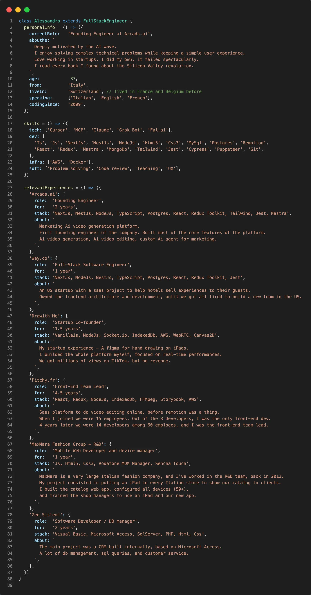

<h1 align="center">Hi everyone 👋 I'm Alessandro</h1>

<!--

-->

 

### 👋 Alessandro, 37, from Italy, based in Switzerland 
### 🧑‍💻 15+ years of experience 
### 💻 Founding Engineer at [Arcads](https://www.arcads.ai)
### 🤖 Into startups, technology and AI
### 👤 [Linkedin](https://www.linkedin.com/in/alessandro-cipolletti/) 
### ✉️ cipolletti.alessandro@gmail.com
 
 

    

## Founding Engineer at [Arcads](https://www.arcads.ai)

<h3>I often work in startups. I like them, and I started one myself.</h3>

## Personal projects

<!-- Copy a bullet below when you add the next repo. -->

- ⌨️ **[Nodeminal](https://github.com/AlessandroCipolletti/Nodeminal)** 
  A Node terminal and a Node app, running locally inside the browser.

- 🧮 **[my-js-math-and-ui-utils](https://github.com/AlessandroCipolletti/my-js-math-and-ui-utils)** 
  TypeScript helpers for math and UI that I keep reusing.

